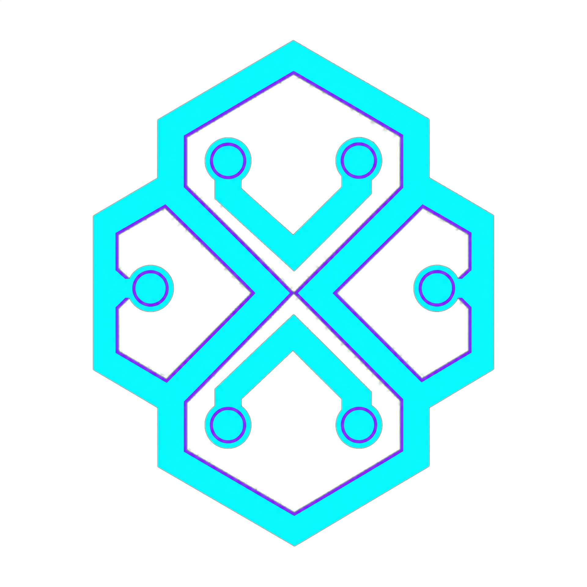

# NEXORA Documentation

Bộ tài liệu được chia theo ngôn ngữ để sau này có thể đưa thẳng vào Docusaurus, Nextra, Starlight hoặc VitePress.

- [Tiếng Việt](./vi/index.mdx)
- [English](./en/index.mdx)
- [Tài sản thương hiệu](./assets/README.mdx)

## Quy ước

Mỗi trang `.mdx` dùng YAML frontmatter gồm `title`, `slug`, `description` và `sidebar_position`. Nội dung theo topic, không phụ thuộc đường dẫn hosting. Hình ảnh dùng đường dẫn tương đối trong `docs/assets/`; secret và dữ liệu khách hàng không được đưa vào tài liệu.
