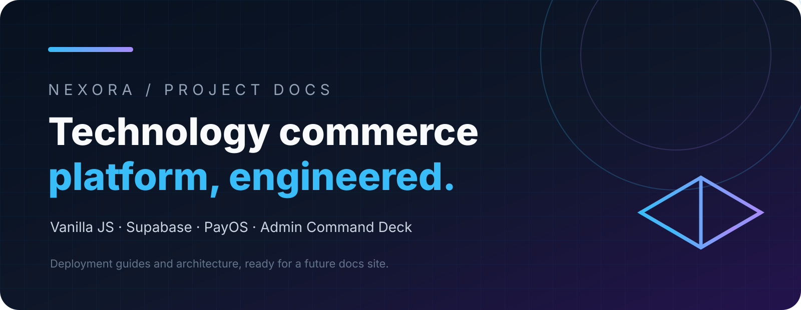

# NEXORA Documentation

Choose a topic:

| Topic | Contents |
| --- | --- |
| [Getting started](./getting-started.mdx) | Clone, install dependencies, configure Supabase, and run locally. |
| [Deployment](./deployment.mdx) | Render, aaPanel, cPanel, static hosting, and the production checklist. |
| [Supabase](./supabase.mdx) | Canonical schema, Auth, RLS, RPCs, and Storage. |
| [Admin](./admin.mdx) | Command Deck, roles, capabilities, CMS, and sale campaign operations. |
| [Payments](./payments.mdx) | PayOS, automatic bank transfer, QR payments, and e-wallets. |
| [Email & security](./email-security.mdx) | SMTP/Resend, password recovery, secrets, and production safety. |
| [Assets](../assets/README.mdx) | Logos, banners, and media conventions. |

## Existing detailed references

Legacy guides remain available for compatibility: [Deployment and user guide](../DEPLOYMENT_GUIDE_EN.md), [PayOS](../PAYOS_SETUP_BILINGUAL.md), [SMTP](../SMTP_SETUP_BILINGUAL.md), [Render](../RENDER_ENV_SETUP_BILINGUAL.md), and [Supabase Storage](../SUPABASE_STORAGE_SETUP.md).
