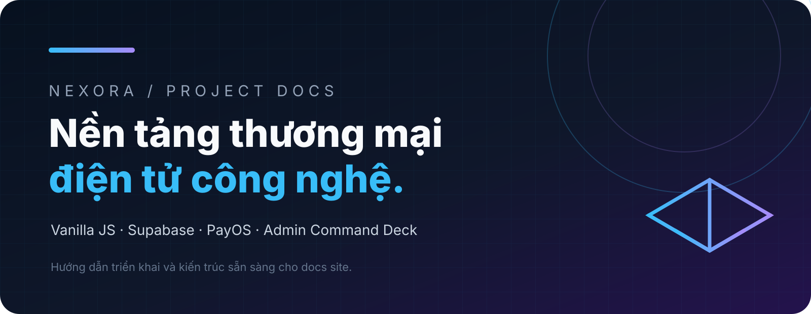

# Tài liệu NEXORA

Chọn theo nhu cầu:

| Chủ đề | Nội dung |
| --- | --- |
| [Bắt đầu](./getting-started.mdx) | Clone, cài dependency, cấu hình Supabase và chạy local. |
| [Triển khai](./deployment.mdx) | Render, aaPanel, cPanel, static hosting và checklist production. |
| [Supabase](./supabase.mdx) | Schema canonical, Auth, RLS, RPC và Storage. |
| [Admin](./admin.mdx) | Command Deck, role, capability, CMS và vận hành sale campaign. |
| [Thanh toán](./payments.mdx) | PayOS, chuyển khoản tự động, QR và ví điện tử. |
| [Email & bảo mật](./email-security.mdx) | SMTP/Resend, recovery password, secrets và an toàn production. |
| [Tài sản](../assets/README.mdx) | Logo, banner và quy ước media. |

## Nguồn chi tiết hiện có

Các tài liệu legacy vẫn được giữ để không gãy liên kết: [Hướng dẫn A–Z](../HUONG_DAN_A_Z.md), [PayOS](../PAYOS_SETUP_BILINGUAL.md), [SMTP](../SMTP_SETUP_BILINGUAL.md), [Render](../RENDER_ENV_SETUP_BILINGUAL.md) và [Supabase Storage](../SUPABASE_STORAGE_SETUP.md).
